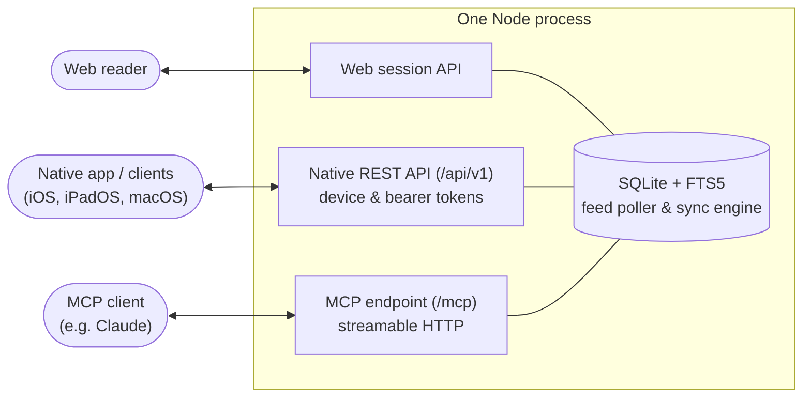

# FeedKeeper

<p align="center">
  <strong>A self-hosted RSS reader, podcast and YouTube client, and remote MCP server.</strong>
</p>

<p align="center">
  <a href="https://github.com/visualfusion/feedkeeper/actions/workflows/ci.yml"></a>
  <a href="https://github.com/visualfusion/feedkeeper/releases"></a>
  <a href="LICENSE"></a>
  <a href="https://modelcontextprotocol.io"></a>
  <a href="#features"></a>
  <a href="#contributing"></a>
</p>

<br />

FeedKeeper is an RSS, Atom, and JSON Feed reader for news, blogs, podcasts, and YouTube channels. It runs on your own server or Raspberry Pi, stores everything in SQLite, and needs no cloud account.

Alongside the web reader, FeedKeeper includes an authenticated **[Model Context Protocol (MCP)](https://modelcontextprotocol.io)** endpoint so MCP clients can read, search, bookmark, and organize your feeds over a remote connection while your subscriptions stay in your database.

It is multi-user by default, with isolated accounts, personal access tokens, and a web interface in English, German, Japanese, and Russian.

<p align="center">
  
  &nbsp;&nbsp;&nbsp;
  
</p>

## Why FeedKeeper?

There are good self-hosted readers already, such as Miniflux and FreshRSS. FeedKeeper is for you if you want your feeds to be part of your AI workflows without giving up ownership:

- **MCP built in.** Claude, ChatGPT and other MCP clients connect to `/mcp` directly, with OAuth sign-in or personal access tokens, read-only or read and write. FeedKeeper is listed in the official Model Context Protocol Registry (`io.github.visualfusion/feedkeeper`) and verified in Claude's connector directory. Ask for a daily briefing, let an agent triage unread articles, or let it curate an edition without running a separate bridge.
- **News, podcasts, and YouTube in one place.** FeedKeeper detects podcast feeds and YouTube channels (including plain channel URLs), gives each its own show or 16:9 video layout, plays audio in a persistent mini-player with chapter markers, embeds YouTube via `youtube-nocookie.com`, and syncs playback positions across devices.
- **Small to run.** One Node process and one SQLite file, with full-text search built in. No PostgreSQL, no Redis. It runs on a Raspberry Pi or on shared hosting such as Uberspace.
- **Open REST API.** `/api/v1` is described in an [OpenAPI file](docs/openapi.yaml), with offline sync, notes and editions, so third parties can build their own clients.
- **Extensible web app.** Operators can add settings, footer links or a single sign-on form to the web app without forking it; see [Extending the web app](docs/extending-the-web-app.md).

If you only need a plain, mature reader with many integrations, the established projects are the safer choice. FeedKeeper is young (version 0.x), so expect some rough edges.

## Quick start

Up and running in about a minute. Prebuilt images for `amd64` and `arm64` (including Raspberry Pi) are published to the GitHub Container Registry. You only need Docker, no clone and no build:

```bash
mkdir feedkeeper && cd feedkeeper
curl -fsSLO https://raw.githubusercontent.com/visualfusion/feedkeeper/main/compose.yaml
echo "SESSION_SECRET=$(openssl rand -hex 32)" > .env
docker compose up -d
```

Open `http://localhost:3000` to complete the initial setup via the web onboarding screen. For a public domain, also add `PUBLIC_URL=https://your.domain` to `.env` (see [`.env.example`](.env.example) for all options).

To try FeedKeeper without Docker, run `npx feedkeeper` (requires a supported Node.js version, see [Running FeedKeeper with Node.js](docs/deployment-npm.md)); data stays in `~/.feedkeeper`.

To update, pull the new image and restart:

```bash
docker compose pull
docker compose up -d
```

Changing `SESSION_SECRET` signs out active browser sessions and makes stored two-factor keys unreadable (see [Account security](docs/account-security.md)); feeds and accounts stay in the database. To build the image yourself, clone the repository and run `docker compose -f compose.yaml -f compose.build.yaml up -d --build`.

Started without a `SESSION_SECRET` (for example from one of the templates below), the image creates one on the first start and keeps it in the data volume.

### Set up with an AI agent (Claude Code, Cursor, Codex)

If you use an AI coding assistant on your server or local machine, you can paste this prompt:

> "Set up and start FeedKeeper on this machine using Docker Compose. Download or reference the template from https://raw.githubusercontent.com/visualfusion/feedkeeper/main/compose.yaml, generate a secure 64-character SESSION_SECRET, set PUBLIC_URL to the address this machine is reachable at, ensure the feedkeeper_data volume is persistent, start the container, and verify that the web onboarding responds on port 3000."

### Other ways to run it

| Where | How |
|---|---|
| **Raspberry Pi** | [Step by step with Docker](docs/deployment-raspberry-pi.md), including HTTPS and backups. |
| **HTTPS reverse proxy** | [Caddy, nginx and Traefik setup](docs/reverse-proxy.md), including forwarded client IPs and MCP client setup. |
| **Coolify, Unraid, CasaOS, Portainer** | [Ready-made templates](docs/deployment-homelab.md) for self-hosting and home-lab platforms. |
| **Node.js, no Docker** | `npx feedkeeper` runs it with no clone and no build, see [Running FeedKeeper with Node.js](docs/deployment-npm.md). |
| **Uberspace or any SSH host** | [Deploying to Uberspace](docs/deployment-uberspace.md). |

## Features

### Feeds & Media

- **Podcasts and persistent audio player.** Detects audio feeds (with manual kind override), shows podcast headers with cover artwork and descriptions, and supports episode artwork (`<itunes:image>`), `<enclosure>`, `itunes:duration`, JSON Feed `attachments`, and `podcast:chapters` (MP3, M4A, FLAC, OGG). A persistent mini-player across the web app offers playback speed controls, clickable chapter markers, and cross-device playback position sync (resetting when an episode finishes).
- **YouTube channels and video feeds.** Subscribe to YouTube channels from their channel URL without a Google account, browse videos in a 16:9 grid, read `<media:description>` notes, watch inline via `youtube-nocookie.com` or HTML5 video enclosures, and filter with `has:audio` and `has:video`.
- **Feed discovery.** Paste a direct feed link or a website address (like `example.com/blog`); FeedKeeper finds RSS, Atom, and JSON Feeds (including YouTube channels, Bluesky, Mastodon, GitHub, Codeberg, Substack, Reddit, and Medium), including ones listed on a site's feed overview page, and checks each one before subscribing.
- **Categories and feed ordering.** Group subscriptions into categories, search and filter the feed list, rename categories in place, and reorder feeds by dragging.
- **Guided onboarding and starter packs.** Start with curated feed lists by interest (News, Technology, Apple, Development, Science, Design, Gaming, Business, Sport, Culture), each feed with a short description, or use single-website discovery or OPML import. The lists are served to native apps via `GET /api/v1/feed-lists`.
- **OPML 2.0 import and export.** Move subscriptions back and forth from Feedly, NetNewsWire, Inoreader, or Reeder at any time.
- **Reliable feed updates.** Fetch several feeds at once with limits per source. Slow feeds and temporary failures do not hold up other updates, and unfinished work resumes after a restart.
- **Automatic character encoding.** Parses UTF-8 as well as legacy ISO-8859-1/Windows-1252 feeds without garbled characters.
- **Authoritative feed icons.** Icons are cached on the server with SHA-256 hashes and conditional ETags, so devices load them without third-party requests.
- **Health monitoring and feed moves.** Status indicators show polling health, consecutive fetch errors, and timestamps for dead feeds. Permanent `301`/`308` redirects update feed URLs automatically, and `410 Gone` responses trigger auto-discovery to offer a one-click replacement.

### Reading, Search & Knowledge

- **Article reader and background preparation.** Read feed content in the app, with shared, bounded full-text extraction, durable retries and source-host limits. Full-text fetching can be tuned per subscription. Reader content omits repeated author and date lines, including standalone inline bylines, while keeping attribution when no author is provided separately. Videos, social posts and audio players, including those held back by consent plugins, become one link that clients show as a card, and lists of related or popular articles inside an article are removed. The cleanup uses [content rules](docs/content-rules.md) that contributors can extend; see [full-text fetching](docs/full-text.md) for settings and limits.
- **List and newspaper views.** Switch between a compact list and an editorial layout with wide lead stories and longer previews; phones always use the newspaper layout.
- **Full-text search and quick filters.** Indexed with SQLite FTS5 across titles, snippets, cached full text, and personal notes. Ranked by BM25 relevance with diacritic-insensitive matching, phrase support, filter operators (`has:audio`, `has:video`, `has:notes`, `is:unread`, `is:starred`, `feed:`), and quick filter chips in the web app.
- **Saved articles as a lasting archive.** Star an article to save it: FeedKeeper keeps its full text and stores its images next to the database, so it stays readable even if the source changes. Saved articles survive cleanups and unsubscribing, ignore the word filter, and their full text is searchable.
- **Article notes.** Attach personal Markdown notes to any article. Notes sync across devices, export to standalone Markdown files, and protect articles from retention cleanups.
- **Universal Inbox (Read-it-Later).** Save web clippings, URLs, and personal notes to your inbox from any browser, share extension, or MCP client. Full article contents and lead images are extracted and archived offline.
- **Curated editions and daily briefings.** Finite morning, midday, and evening editions curated by external agents via MCP (Claude, local LLMs, or custom scripts), with structured, linked editorial overviews. The latest publication remains available until its successor is published. Candidates and publication require readable body text beyond a repeated headline or read-more/player prompt; video/audio-only entries stay in the library and out of new editions, while short reports, summaries and transcripts remain eligible.
- **Keyword mute filters.** Hide articles matching specific keywords before they reach your stream.
- **Empty gallery filtering.** Gallery links with no editorial text (only an image or a read-more prompt) stay out of article lists, search, notifications and curation. Short news and captions remain visible; saved or annotated items remain accessible. Nothing is deleted.

### Web App & Notifications

- **Keyboard shortcuts.** Navigate the article list and newspaper with `J`/`K` (or `↓`/`↑`), open stories with `Enter`/`O`, mark read, star, or open the original with `M`/`S`/`V`, jump to search with `/`, refresh with `R`, mark all read with `Shift+A`, and press `?` for the shortcut overview.
- **Mobile-friendly web app.** Responsive layout with tab navigation and pull to refresh, installable on the home screen, with light, dark and system themes.
- **Works offline.** A service worker lets the installed app start without a connection. It keeps your saved articles and the newest unread ones on the device with their full text and images, so you can read, search and filter them on the train. Changes such as marking read or saving are kept and sent once you are back online. Switch it off in the settings; cached data is removed when you log out.
- **Notifications and home screen shortcuts.** Optional push notifications for new articles of chosen feeds (on iPhone and iPad once the app is on the home screen), unread counts per feed on the app icon, shortcuts to saved articles and adding a feed, and sharing a web address from another app straight into the add-feed dialog. Notifications are encrypted end to end and delivered through your browser vendor's push service; the server creates its push keys on first start and keeps them in the database.
- **Personal profiles.** Each account can set its display name and a profile photo.

### Sync, AI & Operations

- **Remote MCP access.** Stream items directly into Claude or any MCP-compatible environment via Streamable HTTP, with read-only or read-write tokens, OAuth sign-in for connectors such as ChatGPT and Claude (consent page, PKCE, revocable in Settings), and cursor-based paging for incremental sync.
- **No telemetry or tracking.** Your reading data stays in your SQLite database with no external database engines, no analytics, and no tracking.
- **Passkeys and two-factor authentication.** Sign in without a password via WebAuthn browser autofill from the email field, and confirm sensitive actions (passkey registration, 2FA setup, recovery codes) with biometric step-up verification. Optional TOTP two-factor authentication and one-time recovery codes are included; see [Account security](docs/account-security.md).
- **Hardened security.** SSRF protection against internal network probing, rate limiting on authentication, and hashed API tokens.
- **Automated database housekeeping.** Defaults prune read articles (keeping at least the newest 30 entries per feed), enforce maximum item retention, and run SQLite `VACUUM` on schedule.
- **Online backups.** Create verified SQLite backups while the service keeps running.

## How it fits together



One Node process serves the built web reader, the open REST API (`/api/v1`), and an MCP endpoint (`/mcp`, using the [Streamable HTTP transport](https://modelcontextprotocol.io/docs/concepts/transports)), backed by a single SQLite database, the FTS5 search index, and the feed poller.

### Web reader, native apps, and MCP

FeedKeeper uses a single backend with clients tailored to different situations:

- **The web reader** is a straightforward browser interface for day-to-day reading, categorizing feeds, and triaging your stream.
- **Native apps (iOS, iPadOS, macOS)** build on platform features: offline sync via SQLite change logs, personal Markdown notes per article, and daily newspaper editions.
- **Remote MCP access** lets AI tools curate reading lists, search past items, and inspect candidates using the same APIs.

Features developed for native apps (such as article notes and edition scheduling) are exposed through the open API (`/api/v1`) so third-party clients can use them too.

## Back up and restore

Create a consistent SQLite backup while FeedKeeper is running:

```bash
npm run db:backup -- /safe/location/feedkeeper.sqlite
```

Without Docker, run `npm run build` once before using the backup commands. The command refuses to overwrite an existing backup and verifies its integrity. Images of saved articles live in an `archive` folder next to the database (configurable with `ARCHIVE_PATH`); the backup copies them to `<backup>.archive` and restore puts them back. A backup holds the database and the archive, not `SESSION_SECRET`: keep the secret with your backups, because it also protects the two-factor keys in the database (see [Account security](docs/account-security.md)). Keep the backup outside the application directory and copy it to another machine or storage device.

With Docker Compose, create the backup in the mounted data volume and copy it to the host:

```bash
docker compose exec feedkeeper node server/dist/feedkeeper.js backup /app/data/feedkeeper-backup.sqlite
docker compose cp feedkeeper:/app/data/feedkeeper-backup.sqlite ./feedkeeper-backup.sqlite
# only present if you have saved articles with images:
docker compose cp feedkeeper:/app/data/feedkeeper-backup.sqlite.archive ./feedkeeper-backup.sqlite.archive
```

To restore, **stop FeedKeeper first**, then run:

```bash
npm run db:restore -- /safe/location/feedkeeper.sqlite --force
```

Restoring replaces the configured database. Start FeedKeeper again after the command succeeds. Existing backups may need a database migration on startup if they were created with an older version.

For Docker Compose, stop the service and run the restore command in a one-off container with the backup mounted read-only (include the second `-v` flag only if `feedkeeper-backup.sqlite.archive` exists):

```bash
docker compose stop feedkeeper
docker compose run --rm --no-deps \
  -v "$PWD/feedkeeper-backup.sqlite:/restore.sqlite:ro" \
  -v "$PWD/feedkeeper-backup.sqlite.archive:/restore.sqlite.archive:ro" \
  feedkeeper node server/dist/feedkeeper.js restore /restore.sqlite --force
docker compose up -d feedkeeper
```

## Quick start (local development)

Requires Node.js 22.22.2+ (22.x), 24.15+ (24.x), or 26+.

```bash
git clone https://github.com/visualfusion/feedkeeper.git
cd feedkeeper
npm install
cp .env.example .env
# edit .env: at minimum, set SESSION_SECRET (see the comment in the file)
npm run dev:server   # terminal 1
npm run dev:web      # terminal 2
```

Open `http://localhost:5173` and follow the onboarding screen to create the first admin account, or run `npm run setup` in the terminal.

## Deploying

See [docs/deployment-uberspace.md](docs/deployment-uberspace.md) for a step-by-step guide to running FeedKeeper on [Uberspace](https://uberspace.de). The same steps work on any Linux host with SSH access and a supported Node.js version.

For production, build once and run the compiled server:

```bash
npm run build
npm run start
```

### Diagnostics

Run a read-only check of your Node.js version, `SESSION_SECRET`, `PUBLIC_URL`, writable data directories, free disk space, and SQLite database health:

```bash
npx feedkeeper doctor
```

From a cloned repository, run `npm run doctor`, or inside Docker Compose:

```bash
docker compose exec feedkeeper node server/dist/feedkeeper.js doctor
```

## Hosted option

If you would rather not operate a server, [FeedKeeper Cloud](https://feedkeeper.cloud) is a hosted edition run by the same maintainers. This repository stays MIT-licensed and fully self-hostable.

## Connecting an MCP client [](https://glama.ai/mcp/servers/visualfusion/feedkeeper)

**Local stdio mode (Claude Desktop & local tooling).** Run `feedkeeper mcp` (or `node server/dist/mcp-stdio.js`) to start a local stdio MCP server backed by your SQLite database without needing an open port or network configuration.

**With OAuth (ChatGPT, Claude and other connectors).** Add `https://<your-domain>/mcp` as a remote MCP server or custom connector. The client discovers the sign-in on its own: you log in to FeedKeeper, choose **read only** or **read and write** on the consent page, and the client gets a short-lived token (1 hour, refreshed for 30 days). Connected AI assistants are listed under **Settings > MCP** and can be disconnected at any time. `OAUTH_ALLOWED_REDIRECT_HOSTS` can limit which hosts may register. Set `PUBLIC_URL` to the address the client reaches the server at; see [docs/design/mcp-oauth.md](docs/design/mcp-oauth.md).

**With a personal access token (scripts and clients without OAuth).**

1. Log in to the FeedKeeper web UI and go to **Settings > Personal access tokens**.
2. Create a token and copy it immediately, as it is only shown once. Choose **Read only** for clients that only need to browse articles; choose **Read and write** to let the client change feeds or reading state. Existing tokens retain their previous write access.
3. Add an MCP server entry pointing at `https://<your-domain>/mcp`, sending `Authorization: Bearer <token>` as a header. **Settings > MCP** also offers a ready-made Claude Desktop configuration.

Every tool call is scoped to the signed-in user: a client can only see and manage that user's own feeds and items. OAuth tokens work only on `/mcp`.

### Connect via AI assistant prompt

To have an AI assistant configure the MCP connection for you, create a Personal Access Token in **Settings > Personal access tokens** and run:

> "Add FeedKeeper as a remote HTTP MCP server pointing to https://<your-domain>/mcp with Authorization: Bearer <your-token> to my MCP configuration (e.g. claude_desktop_config.json or Cursor MCP settings). Verify the connection by listing my feeds."

### Available MCP tools

| Tool | Description |
|---|---|
| `list_feeds` | List subscribed feeds with unread counts and health status, optionally only feeds with errors |
| `get_feed` | Inspect a single subscribed feed's metadata, subscription settings, unread count and health status |
| `subscribe_feed` | Subscribe to a feed URL or website URL (auto-discovering the feed) |
| `discover_feeds` | Discover available RSS, Atom, and JSON feeds on a website URL |
| `save_to_inbox` | Save a web clipping, URL, or personal note to your inbox with automatic full-text and image archiving |
| `unsubscribe_feed` | Remove a subscription |
| `update_feed` | Change a subscription's feed URL, name, poll interval, full-text setting, push notifications or app icon count; a new URL is validated before it replaces the old one |
| `list_folders` | List folders with feed and unread counts |
| `create_folder` | Create a folder |
| `rename_folder` | Rename a folder |
| `delete_folder` | Delete a folder; its feeds stay subscribed |
| `move_feed_to_folder` | Move a subscription into or out of a folder |
| `refresh_feed` | Request an update of a subscribed feed; respects source pauses and reports pending work |
| `get_digest` | Unread articles grouped by feed with short snippets, the cheapest way to see what is new |
| `get_overview` | Counts for the whole account: unread and saved articles, top feeds, folders and failing feeds |
| `get_new_items` | Fetch unread items, optionally filtered by feed, search, or bookmarks; can leave out article HTML and shorten summaries |
| `list_items` | Page through compact items by time added; use cursors to fetch older or newly added items |
| `get_item` | Fetch one article and its cached content (HTML or plain text) with optional pagination (`offset`, `nextOffset`, `revision`) |
| `fetch_full_text` | Download and cache the full article when the feed only has a teaser; use `get_item` for subsequent paginated parts |
| `search_items` | Search titles and summaries across all items (with optional bookmarks filter) |
| `mark_read` | Mark one or more items as read |
| `mark_unread` | Mark one or more items as unread |
| `mark_all_read` | Mark all subscribed items as read, optionally within a feed or folder |
| `bookmark_item` | Save one or more items; saved items are archived with full text and images |
| `unbookmark_item` | Remove bookmarks from one or more items |
| `list_muted_keywords` | List user's active muted keywords |
| `add_muted_keyword` | Add a keyword to automatically filter out matching articles |
| `unmute_keyword` | Remove a muted keyword rule |
| `export_opml` | Export all subscribed feeds as an OPML 2.0 XML string |
| `import_opml` | Import feeds from an OPML 2.0 XML string |
| `get_edition` | Read the current issue, source and revision, including expired or dismissed state |
| `get_edition_candidates` | Get compact candidates respecting app section preferences, muted keywords, and learned reader feedback (`readerPreferences`) |
| `publish_edition` | Publish an ordered curated issue, replacing the active one; requires the current revision and an idempotency key, with optional topic overviews, layout and expiry |
| `dismiss_edition` | Dismiss the shared issue with revision and replay protection |

Besides tools, the server offers prompts (`daily_briefing`, `catch_up_on_topic`, `saved_reading_list`, `triage_unread`) and resources (`feedkeeper://feeds`, `opml`, `saved`, `digest` and `feedkeeper://items/{id}`) that clients can show as ready-made actions.

Read-only tokens expose only the tools that leave FeedKeeper data unchanged. `get_item` returns stored feed or reader content; `fetch_full_text` downloads the article from its website and needs a read-and-write token. Item actions accept a single `itemId` or up to 200 `itemIds`. `get_new_items`, `search_items` and `list_items` accept `since` and `until` (ISO date or date-time) to filter by publish date. For incremental synchronization, save `newestCursor`, pass it as `after` next time, and follow `nextCursor` as `before` until there are no more pages.

## Native apps

The official **FeedKeeper app** is available on the [App Store](https://apps.apple.com/app/feedkeeper/id6819176523) for **iOS, iPadOS, and macOS**. It currently ships in English, German, and Japanese (Russian is available in the web interface only). The app pairs with your self-hosted instance by scanning the pairing QR code under **Settings > Devices** in your web reader.

The app builds on FeedKeeper's open native API (`/api/v1`) to provide:
- Incremental delta-sync and offline article caching
- Offline action queuing (reading state, stars, and folders sync back automatically)
- Fast full-text search powered by SQLite FTS5
- Synchronized personal Markdown notes per article
- Reading layout preferences and daily newspaper editions

The built-in web reader remains 100% free and fully supported. The native sync API is open and documented in [docs/openapi.yaml](docs/openapi.yaml), and third-party and community clients can build on the same endpoints (see [docs/building-clients.md](docs/building-clients.md) for a getting-started guide).

## Security

- **Closed signup by default** (`ALLOW_SIGNUP=false`). An admin creates additional accounts from Settings.
- **SSRF protection**: feed URLs and redirects are checked before fetching and again when connecting. Private/internal addresses are blocked by default. On trusted instances that need local feeds, set `ALLOW_PRIVATE_FEEDS=true`.
- **Blocked sources**: list domains in `BLOCKED_FEED_HOSTS` (comma-separated, subdomains included) to keep them out of your instance. Subscribing, polling, article text and images are refused for them with the error `feed_blocked`. Feeds already stored stop updating and lose their articles, except saved ones, ones with notes and ones in a published edition. Restart the server after changing the list.
- **Rate limiting** on login and the general API surface.
- **Personal access tokens** are stored as salted hashes, never in plaintext.
- **OAuth 2.1 for MCP** with required PKCE, expiring tokens, refresh-token rotation with reuse detection, and a consent page that asks every time.
- **Behind a proxy or CDN**: `TRUST_PROXY` and `CLIENT_IP_HEADER` make sure rate limits see the real client address.
- **Per-user data isolation**: every query is scoped to the authenticated user; feeds are deduplicated by URL under the hood, but subscriptions, read state, and tokens are always per-user.

Feed icons and the images of saved articles are delivered by the FeedKeeper server, so browsing does not contact third-party sites for them; images of other articles still load from their source websites. To find a feed's icon, the server fetches the site's homepage about once a week. Opening a full article through the reader also fetches that page from the FeedKeeper server.

Report security issues privately as described in [SECURITY.md](SECURITY.md) instead of opening a public issue.

## Configuration

See [.env.example](.env.example) for all available environment variables.

### Feed updates

By default, FeedKeeper checks up to four feeds at once, with at most two requests per source hostname. Scheduled and manual updates, new subscriptions, OPML imports and MCP share the same queue. A manual refresh may stay pending when a source is busy or has asked for a pause; the web reader tells you when this happens.

Run **one application process per database**. On hosts with little memory, start with `POLL_CONCURRENCY=2` and `POLL_HOST_CONCURRENCY=1`. Allow 45 seconds for shutdown; the supplied Docker Compose file already does this. See [Feed polling](docs/feed-polling.md) for the settings, logs and upgrade guidance.

### Reader cleanup

Reader HTML is cleaned when served, without rewriting stored publisher content. Exact adjacent image copies (for example separate desktop/mobile elements) collapse to one; different sources, links, responsive sources, captions and repetitions separated by text remain distinct. Empty product-card headers and ad slots are removed using their container structure and German, English and Japanese labels, while existing advertising content, affiliate disclosures and sponsored-article labels remain readable.

### Article images

The image proxy shares downloads and cached images between subscribers of the same feed, with per-article access checks and separate entries per source URL. The disposable cache defaults to **256 MiB, 2,000 images and six hours** (`IMAGE_CACHE_*` in [`.env.example`](.env.example)), separate from permanent archives for saved articles. See [Article image cache](docs/image-cache.md) for offline isolation, hard links, metrics and rollback options.

## Extending

Operators and products built on FeedKeeper can add settings sections, footer links, a page title and a custom sign-in to the web app through `window.feedkeeperExtensions`, without patching the code. FeedKeeper Cloud, the hosted edition, uses it for its membership settings. See [Extending the web app](docs/extending-the-web-app.md).

## Tech stack

- **Server**: Node.js, TypeScript, Express, better-sqlite3, `@modelcontextprotocol/sdk`
- **Web**: React, Vite, Tailwind CSS, react-i18next, [BudouX](https://github.com/google/budoux) Japanese model ([Apache 2.0](https://www.apache.org/licenses/LICENSE-2.0))

## Contributing

Issues and pull requests are welcome; see [CONTRIBUTING.md](CONTRIBUTING.md) for how to get started. Improving or adding a language is a good first contribution (see [docs/translating.md](docs/translating.md)), as is suggesting a starter feed (see [docs/feed-lists.md](docs/feed-lists.md)). Notable changes are listed in the [changelog](CHANGELOG.md).

## License

[MIT](LICENSE). Third-party licenses (including the Apache License 2.0 copy for the BudouX Japanese model and the MIT License for the oEmbed provider registry) are listed in [THIRD-PARTY-LICENSES.md](THIRD-PARTY-LICENSES.md).

---

<p align="center">Built by <a href="https://www.visualfusion.de">visualfusion</a></p>
